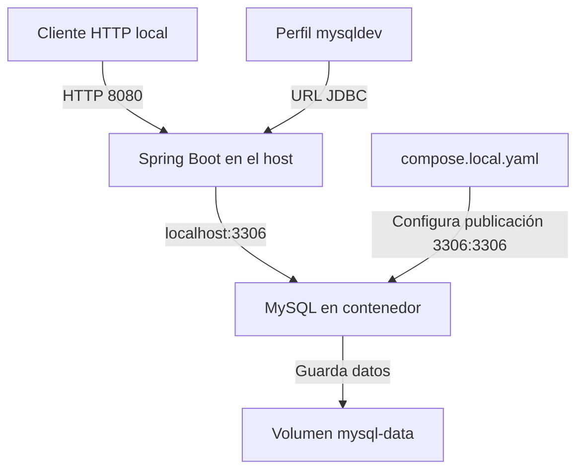
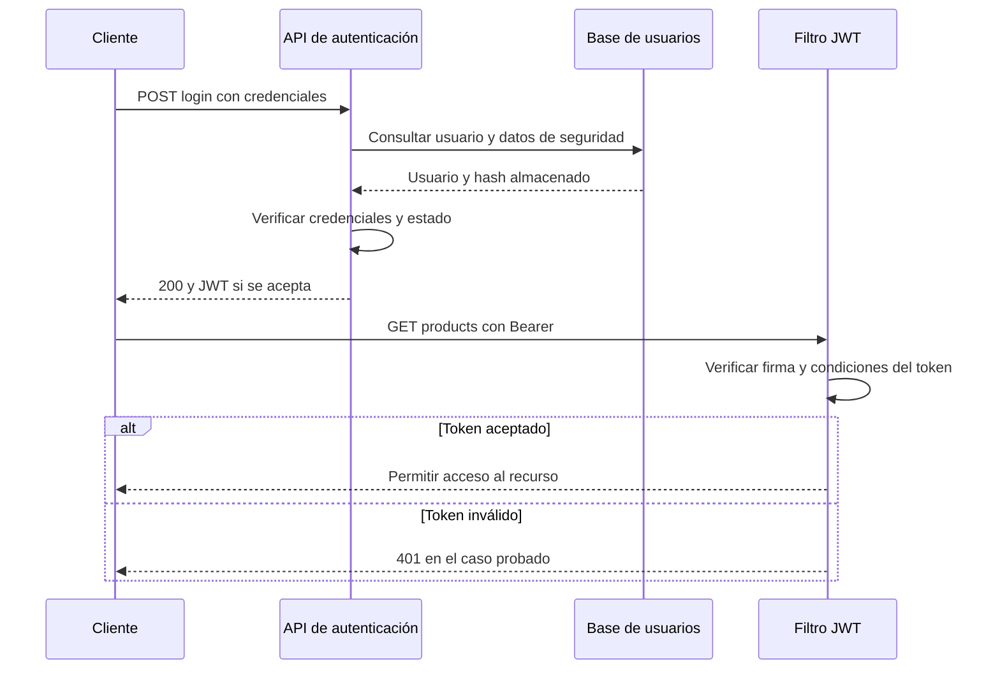

# Apunte 01 — De la base docente a un backend local verificable

**Ingeniería Web III · Integrador 2026**  
**Etapas:** preparación de repositorios, F0 y F1.  
**Fecha:** 20 de octubre de 2026.  
**Estado de referencia:** F1 cerrada y publicada en `f37ad11fe47f68c82ce39cfd4c9aef08d2faec27`, según el reporte de cierre del equipo.

> **Objetivo de este apunte:** entender qué hicimos, por qué lo hicimos y qué demuestra cada resultado. La guía de comandos para operar el entorno está en `docs/desarrollo-local.md`. Este apunte acompaña esa guía y los checkpoints, sin reemplazarlos.

## 1. Qué conseguimos hasta ahora

Partimos de una aplicación del profesor y conseguimos ejecutar nuestra copia con una base MySQL local, configuración propia y autenticación probada mediante HTTP. Además, dejamos el trabajo registrado en Git y documentamos cómo reproducir el arranque.

Eso nos permite comenzar el dominio del integrador sobre una base conocida. **Todavía no implementamos las órdenes de carga de gas ni sus reglas de negocio.** Que funcione el endpoint de productos demuestra que una parte de la infraestructura heredada funciona, no que estén cumplidos los requisitos del integrador.

| Etapa | Pregunta que responde | Resultado |
| --- | --- | --- |
| Preparación | ¿Dónde trabajamos y cómo preservamos la procedencia? | Repositorios propios, copia saneada, configuración local y respaldo remoto |
| F0 | ¿Qué tenemos, qué pide la cátedra y qué falta aclarar? | Inventario, fuentes, matriz de requisitos, decisiones y preguntas de defensa |
| F1 | ¿Podemos arrancar y comprobar la base local? | MySQL, arranque Spring, login/JWT y guía de reproducción |
| F2 | ¿Cómo representamos e implementamos el dominio? | Pendiente de iniciar al cierre de este apunte |

**Ejemplo para explicar el progreso:** ya verificamos que podemos abrir el taller y usar sus herramientas; todavía no construimos la máquina solicitada. Esa distinción evita presentar infraestructura como funcionalidad terminada.

## 2. Repositorios: una base del profesor y un desarrollo propio

### 2.1. Clonar, crear un repositorio propio y conservar la autoría

`git clone` copia un repositorio y su historial. Al clonar la base docente recibimos tanto sus archivos como los commits que explican su evolución.

Crear nuestro repositorio en GitHub y agregarlo como remoto permite publicar el desarrollo del equipo en un espacio independiente. **No convierte el código heredado en código escrito por nosotros.** Por eso conservamos la atribución y registramos el commit original de referencia:

```text
Repositorio docente: magm3333/iw3_2026
Commit original: b7e705de737e5b1039719807bb413ec89279e7d1
```

En GitHub, nuestros repositorios se crearon de forma independiente, sin usar la función de fork. Eso describe cómo se crearon, no elimina su procedencia docente ni prueba que la cátedra exija ese método.

### 2.2. Qué significa cada carpeta

| Carpeta | Función |
| --- | --- |
| `iw3-backend` | Respaldo del clon original con su historial; no es la carpeta activa |
| `iw3-backend-sanitized` | Copia activa del backend, con historial saneado y cambios propios |
| `iw3-frontend` | Repositorio separado del frontend, todavía sin framework |

Dentro del backend activo, la raíz Git contiene documentación y Compose. El proyecto Maven está un nivel más abajo, en `iw3/`. Por eso los comandos de Git/Compose y los de Maven se ejecutan desde directorios distintos.

### 2.3. Remotos y ramas no son lo mismo

Un **remoto** es una dirección de otro repositorio. Una **rama** es una referencia a una línea de commits.

- `origin` identifica nuestro repositorio de GitHub en la copia activa.
- `upstream` identifica el repositorio docente en el respaldo original. No está configurado en la copia activa.
- `feature/setup-inicial` contiene el trabajo de preparación y F0–F1.
- `develop` se prevé como rama de integración y `main` como referencia estable.

Al cierre de F1, `main` y `develop` siguen en la base saneada, sin la externalización posterior, y no se publicaron. **Crear ramas no les copia automáticamente los commits futuros de otra rama.** Será necesario integrar los cambios cuando corresponda.

### 2.4. Qué hace cada paso de Git

| Comando | Qué cambia | Qué no demuestra |
| --- | --- | --- |
| `git status --short` | Nada: muestra archivos pendientes | No verifica compilación ni comportamiento |
| `git add archivo` | Prepara el contenido de ese archivo en el índice | No crea un commit ni sube a GitHub |
| `git diff --cached` | Nada: muestra lo preparado | No ejecuta pruebas |
| `git diff --cached --check` | Nada: detecta problemas de espacios y marcadores de conflicto en los cambios | No es un análisis de secretos ni de lógica |
| `git commit` | Crea un registro local con los cambios preparados | No constituye un respaldo remoto |
| `git push` | Publica commits y actualiza la rama remota correspondiente | No sube archivos locales sin commit |

Un árbol limpio significa que no hay cambios pendientes visibles para Git; puede contener archivos ignorados. Una rama sincronizada significa que coincide con la referencia remota conocida; un push exitoso aporta evidencia de que se publicó en ese momento.

**Lo que aprendimos de un error real:** el primer commit del frontend falló porque faltaban nombre y correo de autor. Como no existía ningún commit, el push posterior también falló. Configurar la identidad local solucionó el commit. Esa identidad es distinta de la autenticación SSH para acceder a GitHub.

## 3. Secretos, historial y archivos locales

### 3.1. Por qué cambiamos credenciales heredadas

La base incluía valores embebidos de configuración sensible. Aunque ya estuvieran publicados por el profesor, el equipo decidió no utilizarlos ni republicarlos en su propio historial público.

Se trabajó en una copia separada y se reemplazaron cuatro valores identificados en el historial. El original quedó como respaldo. Luego se adaptó el código actual para recibir configuración mediante variables de entorno.

Son dos operaciones distintas:

1. **Sanear el historial:** evita incluir esos valores conocidos en los commits que publicamos.
2. **Externalizar la configuración:** evita que la aplicación actual dependa de credenciales escritas en el código.

Borrar un secreto del último archivo no lo borra de commits anteriores. Además, quitarlo de nuestro repositorio no lo vuelve secreto otra vez si ya había sido público; no debe reutilizarse como credencial propia.

### 3.2. Por qué cambiaron los hashes

El identificador de un commit depende de su contenido y de sus referencias, incluido su padre. Al reescribir un commit cambian su hash y los de sus descendientes afectados. No necesariamente cambian todos los commits anteriores.

Eso explica por qué conservamos una referencia al hash original docente y otra a nuestra base saneada. Para traer cambios futuros del profesor, el equipo decidió revisar y aplicar los cambios sin integrar el historial original, que podría volver a incorporar los valores eliminados.

### 3.3. Qué protege `.gitignore`

`.gitignore` evita que ciertos archivos sin seguimiento aparezcan como candidatos normales para agregarse. No borra archivos ya versionados ni modifica el historial. En nuestro caso los archivos locales de instrucciones nunca estuvieron trackeados, por lo que bastó con excluirlos.

Las credenciales locales del backend también están excluidas. Se verificó con `git check-ignore`. El ejemplo `.env.example` sí se versiona: contiene nombres de variables y valores ficticios, para que otra persona sepa qué debe configurar.

| Archivo | Propósito | ¿Se publica? |
| --- | --- | --- |
| `.env.example` | Referencia de variables con ejemplos ficticios | Sí |
| `.env.mysql` | Credenciales de MySQL local | No |
| `.env.jwt` | Secreto de configuración para firmar/verificar JWT HMAC | No |
| `.env.testuser` | Credenciales del usuario de prueba | No |

En HMAC se usa un **secreto compartido**, no una clave privada de un par asimétrico.

Los permisos `600` permiten lectura y escritura al propietario del archivo, sin permisos para grupo u otros usuarios. Es una protección de acceso local; no cifra el archivo ni sustituye las exclusiones de Git.

## 4. F0: inventariar antes de implementar

F0 permitió separar tres cosas que suelen confundirse:

1. **Lo que ya hace la aplicación docente:** categorías, productos, ejemplos de integración, seguridad, correo, eventos y WebSocket.
2. **Lo que modificamos para preparar nuestra copia:** configuración, firma JWT, exclusiones y documentación.
3. **Lo que debemos desarrollar:** el dominio y los casos de uso del integrador.

### 4.1. Para qué sirve cada documento

| Documento | Pregunta principal |
| --- | --- |
| `estado-proyecto.md` | ¿Qué existe y en qué estado estamos? |
| `fuentes.md` | ¿De dónde sale cada afirmación y qué duda conserva? |
| `requisitos.md` | ¿Qué hay que cumplir y cómo se comprueba? |
| `decisiones.md` | ¿Por qué elegimos esta solución? |
| `defensa.md` | ¿Qué debemos poder explicar? |
| `checkpoints/` | ¿Qué cambió, qué se probó y desde dónde seguimos? |

Una matriz de requisitos no es una lista de tareas genéricas. Cada requisito debe tener una descripción comprensible, una fuente, un criterio de aceptación y evidencia. Preparar una tabla no significa cumplir sus requisitos.

### 4.2. Fuente, interpretación y decisión

- **Fuente:** lo que realmente dice el material de la cátedra.
- **Interpretación:** cómo entendemos ese texto en el sistema.
- **Decisión del equipo:** una elección técnica propia, compatible con el alcance.
- **Duda pendiente:** algo que el material no permite resolver con suficiente certeza.

Ejemplo concreto: se reportó una transcripción con densidad entre 0 y 1 y unidad kg/m³. La aparente inconsistencia quedó abierta. No cambiamos la unidad ni eliminamos validaciones solo porque el dato fuera llamado “anecdótico”.

Otra lección: una respuesta de consulta atribuyó a Clase 3 un comando detallado de MySQL que no estaba en el texto revisado. Se descartó esa atribución. La imagen `mysql:8.0.43` se identificó mediante lectura directa de la tabla de servicios de Clase 7, según el reporte del equipo. Una respuesta generada ayuda a buscar; no reemplaza la fuente.

## 5. F1: MySQL local con Docker

### 5.1. Imagen, contenedor y volumen

Una **imagen** contiene lo necesario para crear un contenedor. Un **contenedor** es una instancia de esa imagen con sus procesos y configuración. Un **volumen** conserva datos fuera de la capa escribible del contenedor.

En nuestro caso:

| Elemento | Valor usado |
| --- | --- |
| Imagen | `mysql:8.0.43` |
| Servicio Compose | `mysql` |
| Contenedor observado | `iw3-local-mysql-1` |
| Volumen | `iw3-local_mysql-data` |
| Base | `iw3_2026` |
| Usuario de aplicación | `iw3_app` |

Recrear un contenedor para cambiar su puerto no obliga a perder la base: reutiliza el volumen. En cambio, eliminar el volumen elimina ese almacenamiento. Por eso no usamos `down -v` para reiniciar o corregir puertos.

### 5.2. Quién corre dónde



Spring se ejecutó en Ubuntu mediante Maven; **no se creó un contenedor para el backend**. MySQL sí corre en Docker.

El mapeo `127.0.0.1:3306:3306` expresa dirección del host, puerto del host y puerto del contenedor. Ambos puertos son 3306 por decisión del equipo. No es una obligación de Docker: podrían ser diferentes si el cliente apuntara al puerto publicado correcto.

Antes se había utilizado 33306 en el host. Lo cambiamos a 3306 y ajustamos el perfil `mysqldev`. La configuración base sin perfil todavía conserva 33306. Esa diferencia está documentada: el comando de desarrollo exige activar `mysqldev`.

### 5.3. Compose configura, MySQL inicializa

En `compose.local.yaml`, las variables se traducen a las que entiende la imagen:

| Variable local | Variable del contenedor | Uso |
| --- | --- | --- |
| `DB_USERNAME` | `MYSQL_USER` | Usuario de aplicación inicial |
| `DB_PASSWORD` | `MYSQL_PASSWORD` | Contraseña de ese usuario |
| `MYSQL_ROOT_PASSWORD` | `MYSQL_ROOT_PASSWORD` | Contraseña inicial de administración |
| Valor fijo `iw3_2026` | `MYSQL_DATABASE` | Base inicial |

La aplicación usa el usuario de aplicación, no root. Cambiar estas variables después de inicializar el volumen no equivale a cambiar automáticamente las contraseñas almacenadas en MySQL.

### 5.4. Qué comprobamos realmente

La consulta `SELECT VERSION(), DATABASE(), CURRENT_USER()` confirmó versión, base y usuario. `SHOW TABLES` mostró inicialmente una base sin tablas.

Esa consulta se ejecutó dentro del contenedor: prueba que MySQL responde allí, pero por sí sola no demuestra el acceso desde Ubuntu por el puerto publicado. El posterior arranque de Spring conectado a `localhost:3306` completa esa parte de la evidencia.

## 6. Java, Maven y Spring: tres responsabilidades distintas

### 6.1. Por qué hizo falta un JDK

El JRE permite ejecutar aplicaciones Java. El JDK incluye herramientas de desarrollo, entre ellas `javac`, el compilador. La máquina tenía un JRE; para compilar el proyecto se preparó un JDK 21 portátil.

`JAVA_HOME` indica dónde está ese JDK. Anteponer su directorio `bin` a `PATH` permite encontrar sus ejecutables. El Maven Wrapper (`./mvnw`) permite usar la versión de Maven definida para el proyecto.

Compilar verifica que el código puede transformarse a clases Java con esas dependencias. **No demuestra que la BD esté disponible, que las variables estén definidas ni que el login funcione.** Por eso F1 necesitó también arranque y pruebas HTTP.

### 6.2. El error que nos enseñó a separar perfiles

Teníamos dos mecanismos llamados “perfil”:

- El **perfil Maven** cambia propiedades del proceso de build.
- El **perfil Spring** determina configuración y componentes en ejecución.

En este POM, `-Pmysqldev` fija una propiedad Maven, pero no la reenvía automáticamente al proceso que inicia `spring-boot:run`, según el diagnóstico ejecutado por el equipo. Los intentos fallidos usaban la URL base con 33306.

La solución probada fue exportar:

```bash
export SPRING_PROFILES_ACTIVE=mysqldev
```

No hizo falta modificar el POM. Leer una propiedad con `help:evaluate` había confirmado su valor en Maven, pero no el perfil efectivo dentro de Spring.

También hizo falta `-Dbuild=war`: activar otro perfil del mismo POM desactivaba la selección predeterminada de `war-build`, dejando sin resolver el tipo de empaquetado si no se lo elegía explícitamente.

**Combinación utilizada:**

```bash
export SPRING_PROFILES_ACTIVE=mysqldev
./mvnw -Dbuild=war -Pmysqldev spring-boot:run
```

Este fragmento supone que ya se cargaron el JDK y las variables requeridas. El comando completo está en la guía de desarrollo local.

### 6.3. Un archivo `.env` no se carga por existir

Compose lee `.env.mysql` cuando lo indicamos con `--env-file`. La aplicación Java, ejecutada por separado, no recibe automáticamente esas variables.

Para Spring se utilizó Bash:

```bash
set -a
source ../.env.mysql
source ../.env.jwt
set +a
```

`source` evalúa el archivo en la shell actual y `set -a` exporta las variables que se definen. Así el proceso Java hijo las recibe. Solo se deben cargar archivos propios y conocidos, porque `source` ejecuta su contenido.

El patrón `${DB_PASSWORD}` de Spring toma un valor de configuración; no contiene por sí mismo la contraseña. El patrón `${EXPIRED_NOTIFICATION_ENABLED:false}` agrega un valor por defecto.

### 6.4. Tablas creadas por Hibernate

Hibernate es la herramienta de persistencia que relaciona entidades Java con tablas. Con la configuración heredada `ddl-auto=update`, al arrancar creó seis tablas: `categories`, `cli1_products`, `products`, `roles`, `userroles` y `users`.

Eso prueba que las entidades incluidas por el perfil se conectaron con la base. No significa que ya exista el esquema de órdenes del integrador ni que tengamos un sistema de migraciones versionadas para producción.

## 7. Autenticación: BCrypt y JWT cumplen funciones diferentes

### 7.1. Qué pasa al iniciar sesión

El endpoint efectivo es `POST /api/v1/login`, con `username` y `password` como parámetros de formulario. Si las credenciales se aceptan, devuelve un JWT. Para acceder a productos se utiliza el encabezado:

```http
Authorization: Bearer <token>
```

`<token>` es un marcador, no un valor que se pueda usar literalmente.



El diagrama resume el circuito; no reproduce el orden interno de todas las clases o de cada acceso SQL.

### 7.2. Contraseña, hash y secreto JWT

| Elemento | Para qué sirve | Qué no es |
| --- | --- | --- |
| Contraseña del usuario | Demostrar conocimiento al iniciar sesión | No se debe guardar como texto plano en la tabla |
| Hash BCrypt | Permitir comprobar la contraseña presentada | No es un cifrado que se “desencripta” para recuperar la contraseña |
| `JWT_SECRET` | Firmar y verificar tokens con HMAC | No es la contraseña del usuario ni el hash BCrypt |
| JWT | Presentar información firmada en solicitudes posteriores | No es necesariamente información cifrada ni debe publicarse |

BCrypt incorpora una sal: dos hashes de la misma contraseña pueden verse diferentes. La comprobación utiliza la operación de verificación de BCrypt; no compara dos textos generados independientemente como si tuvieran que ser iguales.

En nuestro JWT se usa un secreto compartido para firma/verificación. Si se altera el contenido firmado o la firma de forma que deja de ser válida, debe rechazarse. Tener un token no sustituye las futuras reglas de autorización del dominio.

### 7.3. Cómo se preparó el usuario de prueba

La inspección local reportó que no había un método de alta de usuarios en la API o negocio. Se utilizó la utilidad heredada `/demo/encodepass` para obtener BCrypt y se insertaron usuario, rol y relación directamente en MySQL.

El usuario fue `qa_f1_dfab890c`, con rol `ROLE_QA_TEST`. Las credenciales quedaron fuera del repositorio. Antes de insertar se consultó el esquema real, porque las columnas tenían nombres `snake_case` como `id_user`.

Se establecieron explícitamente las banderas de cuenta habilitada, no bloqueada, no expirada y credenciales no expiradas. Un INSERT SQL directo no ejecuta los valores iniciales de un objeto Java.

**Límite:** esto preparó datos para una prueba. No implementó registro de usuarios ni roles funcionales del integrador. Tampoco convierte al endpoint de ejemplo para generar hashes en una función destinada a producción.

### 7.4. Qué demostraron las pruebas

| Caso | Resultado registrado | Qué demuestra |
| --- | --- | --- |
| Login correcto | 200 y JWT | El circuito de autenticación aceptó el usuario preparado |
| Recurso protegido con JWT válido | 200 | El token emitido fue aceptado en ese recurso |
| Contraseña incorrecta | 401 | Se rechazaron credenciales incorrectas en ese caso |
| Token alterado | 401 | La alteración ensayada fue rechazada; el log informó firma inválida |
| Sin token | 401 | Ese recurso no permitió acceso anónimo |

El caso sin token se verificó antes y no se repitió. No se probaron aquí expiración del JWT, todos los tipos de token inválido ni permisos por roles de negocio. Una prueba aislada de firma previa tampoco reemplaza estas pruebas HTTP: cada una verifica una capa diferente.

## 8. Correo: parametrizar no es probar el envío

Encontramos direcciones del profesor con funciones distintas: remitente, destinatario y contacto de documentación. No era correcto reemplazarlas todas indiscriminadamente por una única dirección.

- `SMTP_USER` identifica la cuenta usada para autenticarse ante el servidor de correo.
- `MAIL_FROM` configura el remitente, que debe ser autorizado por el proveedor.
- `NOTIFY_TEST_RECIPIENT` configura el destinatario del job heredado.
- El contacto de OpenAPI es metadato de documentación, no un destinatario de envío.

Durante F1 se parametrizaron los datos operativos y se utilizaron valores SMTP ficticios. No se verificó el proveedor de la cuenta institucional ni se envió correo real.

El job heredado `expired()` ahora retorna al comienzo si `EXPIRED_NOTIFICATION_ENABLED=false`. Esto evita depender de una excepción por un repositorio ausente para impedir el envío.

**Una dirección vacía no es una política de deshabilitación:** puede provocar un intento fallido. La condición explícita sí expresa la decisión. Aun así, ese flag solo controla ese job; no deshabilita globalmente `EmailBusiness` ni todos los endpoints que pudieran usarlo.

## 9. Cómo justificamos el trabajo frente a la cátedra

| Trabajo realizado | Justificación | Límite de la afirmación |
| --- | --- | --- |
| Inventario de la base | Permite reutilizar el patrón y explicar qué pertenece al profesor | No cuenta como implementar nuestro dominio |
| Consulta y trazabilidad de fuentes | Reduce suposiciones y permite defender requisitos | Las dudas conservadas no se consideran resueltas |
| MySQL en Docker | Aplica los conceptos de contenedor, configuración y persistencia trabajados en clase | La configuración local es una decisión del equipo |
| Configuración externa | Permite que cada entorno use sus propios valores | No equivale a una auditoría completa de seguridad |
| Prueba de login y JWT | Comprueba una base técnica necesaria para endpoints protegidos | No prueba los roles funcionales de la entrega |
| Documentación y checkpoints | Permiten reproducir, explicar y retomar el trabajo | No sustituyen comprender el código ni practicar la defensa |

La evaluación individual exige que cada integrante pueda explicar el sistema completo. Por eso conviene entender el recorrido de una solicitud y las decisiones, además de saber ejecutar los comandos.

El alcance parcial sin UI propia y el alcance posterior del frontend están registrados en la documentación de fuentes y requisitos. F1 no incorpora nuevas exigencias de cátedra ni resuelve las dudas pendientes de contrato, densidad, alarmas o fechas.

## 10. Errores reales y aprendizaje que dejan

| Situación | Causa identificada | Aprendizaje |
| --- | --- | --- |
| Push inicial por HTTPS fallido | No había autenticación configurada para ese entorno | Autoría Git y acceso al remoto son problemas distintos |
| Commit inicial FE fallido | Faltaba identidad local | Sin commit inicial no hay una rama con contenido para publicar |
| No se podía compilar | Había JRE, no JDK | Ejecutar Java y compilar Java requieren herramientas diferentes |
| Build con perfil sin empaquetado fallido | No quedaba definido `packaging.type` | Revisar perfiles de build antes de cambiar dependencias |
| Spring intentaba JDBC en 33306 | El perfil runtime no estaba activo | Verificar la configuración efectiva en ejecución |
| Job heredado dependía de un fallo para no enviar | Configuración de ejemplo no adaptada al entorno | Deshabilitar explícitamente una función que no se quiere ejecutar |
| Nota decía que destinatario vacío evitaba correo | Se confundía ausencia de dato con condición de control | Contrastar la explicación documental con el código |

## 11. Checkpoint, registro local y grafo: para qué sirve cada uno

El **checkpoint versionado** registra estado, evidencia, cambios, límites y próximo paso. Es la referencia compartida para retomar el proyecto.

Los registros auxiliares locales de sesión ayudan a recuperar contexto operativo. El grafo del código y documentación ayuda a explorar relaciones y a localizar componentes. Ninguno de esos recursos demuestra por sí solo que una función sea correcta.

En el análisis anterior del grafo aparecieron advertencias de aristas colgantes y ruido asociado a archivos JavaScript minificados de terceros. Una conexión semántica de baja confianza no debe convertirse en un requisito o una relación técnica confirmada sin inspección.

Al incorporar este apunte se puede actualizar el registro local y el grafo. Eso es mantenimiento de contexto, **no una nueva ejecución de F1 ni un motivo para repetir todas sus pruebas**. Los archivos auxiliares permanecen fuera de Git según las exclusiones acordadas.

## 12. Evidencia y estado exacto al cerrar F1

| Referencia | Qué respalda |
| --- | --- |
| `0ab399f` | Documentación revisada de F0 |
| `923a752` | Cierre formal de F0 |
| `62a9d53` | Exclusión de resultados locales del grafo |
| `cf64c61` | Cambios de F1, guía y checkpoint 04 |
| `f37ad11` | Cierre formal de F1 y checkpoint 05 |

Según la salida y el reporte compartidos, la rama `feature/setup-inicial` quedó sincronizada con `origin` y sin cambios pendientes al cerrar F1. Este apunte es posterior y todavía debe incorporarse al repositorio si el equipo decide versionarlo.

**Fuentes de este apunte:** archivos de la revisión F1 recibida, documentación revisada de F0–F1 y reportes de ejecución/cierre compartidos por el equipo. El contenido exacto del checkpoint 05 no se volvió a leer; su hash y su alcance provienen del reporte de cierre. No se ejecutaron nuevas pruebas al redactar este material ni se volvieron a consultar los apuntes completos de cátedra.

### Qué sigue abierto

- F2 no iniciada: dominio de órdenes y reglas funcionales pendientes.
- Arranque real sin `JWT_SECRET` no probado.
- `main`/`develop` sin publicar y sin las adaptaciones de la rama activa.
- SMTP real, remitente autorizado y roles funcionales pendientes.
- Dudas de densidad, contrato de activación, aceptación de alarmas, fechas 2026 y decisiones FE todavía abiertas.
- Preguntas de defensa preparadas, sin práctica oral registrada.

## 13. Preguntas para practicar la defensa

Intentá responder primero sin mirar. Estas respuestas son una guía, no constancia de una práctica realizada.

**1. ¿Qué parte hicieron ustedes y qué parte venía del profesor?**  
La base Spring, productos/categorías y ejemplos de integración son docentes. Nosotros preparamos los repositorios, saneamos la copia, externalizamos configuración, adaptamos el entorno local, controlamos el job de correo y verificamos el circuito de autenticación. El dominio propio todavía no está implementado.

**2. ¿Por qué no alcanza con borrar la contraseña del archivo actual?**  
Porque los commits anteriores pueden conservarla. Por eso se saneó el historial que se iba a publicar y se dejó de usar la configuración sensible embebida.

**3. ¿Por qué Compose puede encontrar una variable que Spring no encuentra?**  
Porque son procesos distintos. `--env-file` aporta valores a Compose; Java necesita recibirlos en su propio entorno o mediante otra fuente de configuración.

**4. ¿Qué pasaría si recreás el contenedor?**  
Los datos siguen si reutilizo el volumen. Eliminar el volumen es otra operación y puede perder la base.

**5. ¿Por qué `-Pmysqldev` no resolvió el problema?**  
Porque selecciona un perfil Maven y en este proyecto no propaga automáticamente el perfil a Spring. Definimos `SPRING_PROFILES_ACTIVE` y comprobamos el perfil y la URL efectiva en ejecución.

**6. ¿Qué diferencia hay entre BCrypt y JWT?**  
BCrypt permite verificar una contraseña a partir de su hash. JWT permite presentar información firmada en solicitudes posteriores. El secreto HMAC firma/verifica tokens; no es el hash de la contraseña.

**7. ¿Un 200 con el rol de prueba valida los roles del integrador?**  
No. Demuestra acceso autenticado a ese recurso. Los permisos funcionales por rol requieren implementación y pruebas específicas.

**8. ¿Cómo evitaron que el job enviara al profesor?**  
Eliminamos su destinatario por defecto y agregamos una condición explícita que deshabilita ese job. No dependemos de errores de repositorio ni de un destinatario vacío.

**9. ¿Compilar demuestra que el backend funciona?**  
Solo una parte. Después verificamos arranque, conexión a MySQL y respuestas HTTP para comprobar configuración y comportamiento real.

**10. ¿Por qué F1 puede cerrarse si hay pendientes?**  
Porque cumplimos el alcance acordado de base local y autenticación, y registramos sus límites. Cerrar una fase no significa terminar todo el integrador ni dar por aprobadas pruebas que no hicimos.

## 14. Cómo usar este apunte

1. Leerlo junto con la guía de desarrollo local.
2. Recorrer en el código los archivos mencionados y ubicar cada responsabilidad.
3. Explicar oralmente los dos diagramas sin leer el texto.
4. Responder las preguntas y registrar cuáles necesitan repaso.
5. Incorporarlo como fuente de estudio al cuaderno de progreso.

Los diagramas están escritos en Mermaid para conservar relaciones exactas y editables. No son capturas de ejecución ni evidencia de resultados. Si la herramienta de estudio no renderiza Mermaid, conservar el texto y exportar los diagramas como imágenes desde un visor compatible.
